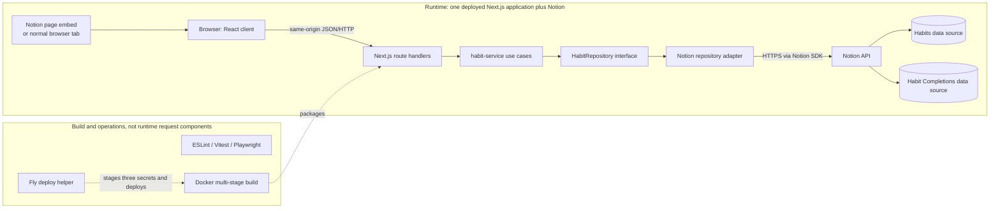

# pockt habits

`pockt habits` is a private, Notion-backed habit tracker. It renders one local
Monday-through-Sunday grid, can be opened directly or embedded in a Notion page,
and lets one user create, edit, archive, reorder, and check off daily habits.

This README is the complete three-stage repository onboarding guide. It explains
the system boundary, repository map, local workflow, representative execution
paths, data behavior, computational trade-offs, failure investigation, and a
practical learning progression.

## Table of contents

- [How to read the evidence](#how-to-read-the-evidence)
- **Stage 1 — Build the repo map**
  - [1. Purpose and boundaries](#1-purpose-and-boundaries)
  - [2. Repository and architecture map](#2-repository-and-architecture-map)
  - [3. Local development and first reading path](#3-local-development-and-first-reading-path)
- **Stage 2 — Connect execution, data, and algorithms**
  - [4. Trace representative existing flows](#4-trace-representative-existing-flows)
  - [5. Data lifecycle — FODE](#5-data-lifecycle--fode)
  - [6. Data behavior and guarantees — DDIA](#6-data-behavior-and-guarantees--ddia)
  - [7. Computational reasoning — Algorithmic Thinking](#7-computational-reasoning--algorithmic-thinking)
- **Stage 3 — Learn to investigate and explain the repo**
  - [8. Failure, security, and performance](#8-failure-security-and-performance)
  - [9. Design trade-offs and learning summary](#9-design-trade-offs-and-learning-summary)
  - [10. Practical onboarding path](#10-practical-onboarding-path)
- [Onboarding success checklist](#onboarding-success-checklist)

## How to read the evidence

- **Verified** means the statement is supported by the inspected code,
  configuration, or a command run in this workspace.
- **Inferred** means it is the most likely interpretation of the evidence, but
  it is not established by production telemetry or a maintainer statement.
- **Unknown** means the repository does not contain enough evidence.

Inspection scope:

- **Revision:** `main` at `0d95d0a` (`chore: add fly deployment helper`), before
  this README revision.
- **Inspected:** repository instructions, existing README and design/setup docs,
  manifests and lockfile, all application/domain/server/UI source, route
  handlers, tests, test configuration, and Docker/Fly deployment files.
- **Grouped rather than inspected file-by-file:** generated `.next/` output,
  third-party `node_modules/`, and test artifacts.
- **Not treated as revision evidence:** untracked `.agents/` and `openspec/`
  workspace metadata.
- **Access limits:** no live Notion workspace, Fly application, production logs,
  traffic measurements, or deployed service was inspected. Secret values were
  not read or printed.

## Stage 1 — Build the repo map

### 1. Purpose and boundaries

#### What problem does this solve?

**Verified:** this is a single private web application, not a monorepo, reusable
library, general-purpose habit platform, or data pipeline. Its output is an
interactive weekly habit grid served by Next.js plus a small JSON API. The
approved Phase 1 scope is recorded in the
[design spec](docs/specs/notion-habit-tracker-phase-1-design-spec.md#L3).

The main capabilities are:

| Capability | User-visible behavior | Primary evidence |
|---|---|---|
| View the week | Show active habits grouped into four slots across exactly seven local dates | [`getWeek`](src/server/habit-service.ts#L27), [`HabitGrid`](src/ui/HabitGrid.tsx#L32) |
| Manage habits | Create, rename, move between slots, and archive without deleting history | [`HabitTracker`](src/ui/HabitTracker.tsx#L169), [`archiveHabit`](src/server/notion/repository.ts#L198) |
| Track completion | Set the desired completed/incomplete state for one habit/date cell | [`handleToggle`](src/ui/HabitTracker.tsx#L140), [`setCompletion`](src/server/habit-service.ts#L114) |
| Reorder habits | Drag rows within one slot and persist numeric sort positions | [`dropHabit`](src/ui/HabitGrid.tsx#L40), [`reorderHabits`](src/server/habit-service.ts#L76) |
| Operate the service | Expose a shallow health endpoint and package the app for Fly.io | [`GET /api/health`](app/api/health/route.ts#L3), [`fly.toml`](fly.toml#L6) |

#### Actors and domain language

- **User:** the person viewing the app directly or through a Notion embed.
- **Browser UI:** React client code that owns interaction state, optimistic
  updates, dialogs, and accessibility behavior.
- **App server:** Next.js route handlers that validate requests and invoke use
  cases. It is stateless with respect to durable habit data.
- **Notion internal connection:** a server-side credential with access to the
  two required Notion data sources. The browser must never receive it.
- **Habit:** a Notion page with `Name`, `Slot`, `Status`, and `Sort Order`.
- **Completion:** a Notion page relating one habit to one local date.
- **Slot:** exactly one of `Morning`, `Midday`, `Evening`, or `Anytime`.
- **Active/Archived:** lifecycle status. Archive is a soft delete from the
  active tracker, not deletion of the habit or its completion history.

#### Domain rules, separate from code types

These are business rules, regardless of how TypeScript represents them:

1. Every visible habit is active and belongs to exactly one approved slot.
2. Every active habit is expected every day in Phase 1; recurrence rules are
   not modeled.
3. The visible range is one local Monday-through-Sunday week.
4. Rows are grouped in slot order and sorted within a slot by `Sort Order`, then
   name and ID as deterministic fallbacks
   ([`groupHabitsBySlot`](src/domain/habits.ts#L44)).
5. Completion means that a matching completion page exists for the
   `(habit, local date)` pair; there is no separate boolean field.
6. A desired completion state should be idempotent: asking for “completed”
   twice should leave one active completion, and asking for “incomplete” should
   archive all matching active completions
   ([`ensureCompletion`](src/server/notion/repository.ts#L215)).
7. Archived habits cannot receive new completion writes
   ([`setCompletion`](src/server/habit-service.ts#L118)).
8. Reordering must include every active habit in one slot and cannot cross slot
   boundaries ([`reorderHabits`](src/server/habit-service.ts#L76)).

The TypeScript domain vocabulary is centralized in
[`src/domain/habits.ts`](src/domain/habits.ts#L1), while local date construction
lives in [`src/domain/week.ts`](src/domain/week.ts#L1).

#### Inside and outside this repository

Inside the repo:

- the Next.js page and HTTP route handlers;
- React interaction and presentation code;
- domain validation/grouping and use-case coordination;
- the Notion API adapter;
- unit, component, end-to-end, and deployment-helper tests;
- Docker and Fly.io packaging/deployment configuration.

Outside the repo:

- the Notion page that embeds the app;
- the Notion API and the two data sources that hold all durable application
  data;
- the internal connection and its permissions;
- Fly.io runtime infrastructure and secrets;
- access control in front of the deployed URL.

**Important boundary:** no authentication or authorization layer was observed
in the app. The design assumes a private personal deployment and warns that a
shared URL needs an access gate
([design spec](docs/specs/notion-habit-tracker-phase-1-design-spec.md#L256)).

### 2. Repository and architecture map

#### Runtime system design

“System design” here means the running components and how they communicate. A
folder is not automatically a service: this repo builds one Next.js process.



System Design Interview lens:

- **Requirements drive the boundary.** A private, single-workspace tracker can
  use one deployable web app and Notion as its external system of record. The
  code does not claim multi-tenant isolation, offline operation, or analytics.
- **The browser/server split protects credentials.** Only server code imports
  the Notion client and reads `NOTION_TOKEN`; the UI calls same-origin routes.
- **The app has no durable local state.** Restarting the process loses only
  in-memory coordination such as completion locks, not habits or completions.
- **The main trade-off is external simplicity versus dependency.** Avoiding a
  parallel database removes synchronization ownership, but every real read and
  write depends on Notion API availability and semantics.
- **Scale is not yet evidenced.** This architecture fits the stated personal
  use case. There are no production request rates, latency measurements, or
  capacity targets from which to justify a scaling change.

DDIA lens: Notion is the **source of truth**—the authoritative durable copy.
The seven-day grid is a derived read model assembled on request by combining
habits and completions in memory. No replication, partitioning, durable cache,
or secondary application database was observed.

FODE lens: this is operational application data, not an analytical data
platform. User actions generate data, the server ingests and validates it, and
Notion stores and serves it back. No warehouse, lake, batch scheduler, event
stream, or ML pipeline was observed.

Algorithmic Thinking lens: the main computational work is local date generation,
grouping/sorting rows, assembling completion lookup state, and drag-order list
manipulation. Stage 2 will analyze representative examples without confusing
in-memory cost with Notion network latency.

#### Software design and dependency direction

“Software design” means how modules and interfaces divide responsibility inside
the one application:

```text
app/page.tsx
  -> src/ui/HabitTracker.tsx
       -> src/ui/api.ts -> /api/* over HTTP

app/api/**/route.ts
  -> src/server/habit-service.ts
       -> src/server/repository.ts (interface)
            <- src/server/notion/repository.ts (implementation)
                 -> @notionhq/client

domain helpers/types <- UI, service, and adapter
```

The useful dependency rule is: route handlers know the concrete Notion adapter,
the service knows only the `HabitRepository` interface, and the UI knows only
the same-origin `HabitTrackerApi`. That separation lets service and UI tests use
fakes without a live Notion workspace.

#### Annotated top-level map

```text
app/                  Next.js App Router page, global styles, and HTTP endpoints
src/domain/           Framework-independent habit and local-week rules
src/server/           Use cases, request/error handling, repository contract
src/server/notion/    Notion SDK adapter and raw response mapping
src/ui/               Interactive React tracker, dialogs, grid, browser API
tests/                 Domain/server/UI tests, mocked-browser E2E, deploy tests
docs/                  Phase 1 design, Notion setup, historical implementation plan
scripts/               Fly deployment helper
Dockerfile             Production image build/run contract
fly.toml               Fly app, region, port, machine sizing, auto-stop behavior
package*.json          npm commands, exact direct dependencies, locked dependency graph
*.config.*             Next.js, TypeScript, ESLint, Vitest, and Playwright configuration
```

Generated/third-party areas are `.next/`, `node_modules/`, `test-results/`, and
`playwright-report/`; learn their producers rather than treating their contents
as first-party design.

#### Major areas and public interfaces

| Area | Responsibility and entry point | Depends on | Public interface | Representative file |
|---|---|---|---|---|
| App shell | Map `/` to the tracker; provide document metadata/styles | React UI | HTML page at `/` | [`app/page.tsx`](app/page.tsx#L1) |
| Route handlers | Translate HTTP input/output and errors around service calls | Server service and concrete Notion repository | `/api/*` listed below | [`app/api/habits/week/route.ts`](app/api/habits/week/route.ts#L7) |
| Domain | Define slots/entities, validate names/dates, group/sort rows, construct weeks | JavaScript date/string primitives only | Exported types and pure functions | [`src/domain/habits.ts`](src/domain/habits.ts#L1) |
| Service | Enforce use-case rules and assemble the weekly response | Domain + `HabitRepository` | `getWeek`, CRUD/reorder/completion functions | [`src/server/habit-service.ts`](src/server/habit-service.ts#L27) |
| Repository contract | Isolate the service from storage technology | Domain types | `HabitRepository` | [`src/server/repository.ts`](src/server/repository.ts#L27) |
| Notion adapter | Query/paginate/map Notion pages and perform writes | Notion SDK, env validation, domain parsers | `createNotionHabitRepository*` | [`src/server/notion/repository.ts`](src/server/notion/repository.ts#L129) |
| UI orchestration | Load the week, own transient state, apply/rollback optimistic changes | UI API, domain dates, presentational components | `HabitTracker` React component | [`src/ui/HabitTracker.tsx`](src/ui/HabitTracker.tsx#L24) |
| UI presentation | Render accessible grid and modal interactions | React + domain/UI types | Component props/callbacks | [`src/ui/HabitGrid.tsx`](src/ui/HabitGrid.tsx#L32) |
| Tests | Specify domain rules, mappings, interactions, and packaging behavior | Vitest/RTL/Playwright | `npm test`, `npm run test:e2e` | [`tests/server/habit-service.test.ts`](tests/server/habit-service.test.ts#L19) |
| Deployment | Validate/stage secrets, build a container, deploy one Fly app | Node, Docker, Fly CLI | `npm run deploy:fly` | [`scripts/fly-deploy.mjs`](scripts/fly-deploy.mjs#L27) |

#### HTTP interface

All business routes construct a Notion repository per request and map known
service errors to JSON. Route handlers are dynamic at request time; the `/`
page itself can be prerendered because data loads in the client after hydration.

| Method and path | Purpose | Success result |
|---|---|---|
| `GET /api/health` | Process-level liveness only; it does **not** verify Notion | `{ "ok": true }` |
| `GET /api/habits/week?start=YYYY-MM-DD&today=YYYY-MM-DD` | Load active habits and completions for seven dates | `WeekResponse` |
| `POST /api/habits` | Create an active habit | Canonical habit, HTTP 201 |
| `PATCH /api/habits/:id` | Update name and/or slot | Canonical habit |
| `DELETE /api/habits/:id` | Set the habit status to `Archived` | Canonical archived habit |
| `PATCH /api/habits/order` | Persist all IDs for one active slot in desired order | `{ "ok": true }` |
| `PUT /api/completions/:habitId/:date` | Ensure `{ completed: boolean }` is the desired state | `{ completion }` |

#### Important guarantee limits

- **Verified:** same-process completion requests for one habit/date are
  serialized by an in-memory `Map`
  ([`runWithCompletionLock`](src/server/habit-service.ts#L6)).
- **Limit:** that lock is not shared across Fly machines or Node processes. The
  Notion schema shown in this repo has no observable unique constraint on the
  habit/date pair. The adapter detects existing duplicates and archives extras,
  but two processes could still race between query and create.
- **Verified:** UI completion and reorder changes are optimistic and roll back
  local state when the request fails
  ([`handleToggle`](src/ui/HabitTracker.tsx#L140),
  [`handleReorder`](src/ui/HabitTracker.tsx#L116)).
- **Limit:** reordering issues parallel Notion page updates, not a transaction
  ([`reorderHabits`](src/server/notion/repository.ts#L234)). A partial upstream
  write is possible even if the UI restores its previous order.
- **Verified:** unexpected errors become a generic HTTP 500 response
  ([`toErrorResponse`](src/server/errors.ts#L13)).
- **Unknown:** production retry policy, rate-limit behavior, timeouts, structured
  logging, metrics, alerting, and recovery procedures are not defined here.

#### Documentation conflicts and drift

- The historical implementation plan names TypeScript `7.0.2` and ESLint
  `10.8.1`, while the current manifest pins TypeScript `6.0.3` and ESLint
  `9.39.5`. Treat [`package.json`](package.json) and
  [`package-lock.json`](package-lock.json) as current dependency evidence.
- The design requires at most one active completion per habit/date. The code
  makes a best effort through query-before-create, duplicate cleanup, and a
  process-local lock; it does not prove global uniqueness.
- The design describes horizontal scrolling in a narrow embed, while the current
  mobile CSS removes horizontal scrolling and compresses the grid
  ([`app/globals.css`](app/globals.css#L367)). The current code and E2E layout
  assertions describe implemented behavior.

### 3. Local development and first reading path

#### Prerequisites

Known-good toolchain versions in the inspected workspace:

- Node.js `22.23.1` (**verified locally** and pinned by
  [`Dockerfile`](Dockerfile#L4));
- npm `10.9.8` (**verified locally**; no `packageManager` or `engines` field pins
  it in `package.json`);
- npm lockfile version 3;
- application stack pinned by the manifest: Next.js `16.3.1`, React `19.2.8`,
  Notion SDK `5.25.2`, Zod `4.4.3`, and TypeScript `6.0.3`;
- a modern browser; Playwright uses Chromium desktop and Pixel 7-sized Chromium
  projects;
- for real data, a Notion internal connection and the two data sources described
  in [`docs/notion-setup.md`](docs/notion-setup.md#L1);
- for deployment only, an authenticated Fly CLI and access to the `pockt` Fly
  app.

No local database, Redis, queue, object store, or container is required for the
test suites. Real application reads and writes do require network access to
Notion.

#### Configure Notion-backed development

Create the two Notion data sources and grant the internal connection access to
both. Then place these names in an ignored `.env.local` for Next.js development:

```dotenv
NOTION_TOKEN=replace_with_internal_connection_token
NOTION_HABITS_DATA_SOURCE_ID=replace_with_habits_data_source_id
NOTION_COMPLETIONS_DATA_SOURCE_ID=replace_with_completions_data_source_id
```

Use **data source IDs**, not parent page/database IDs. The server validates all
three names in [`getEnv`](src/server/env.ts#L4). Do not prefix them with
`NEXT_PUBLIC_`, expose them to browser code, print their values, or commit the
environment file.

The required Notion schemas are:

```text
Habits
  Name: Title
  Slot: Select(Morning | Midday | Evening | Anytime)
  Status: Select(Active | Archived)
  Sort Order: Number

Habit Completions
  Habit: Relation -> Habits
  Completed Date: Date
```

#### Install and run

From the repository root:

```bash
npm ci
npm run dev
```

`npm ci` installs exactly the locked graph and replaces `node_modules`; use
`npm install` only when intentionally changing dependencies. Installation was
**inspected, not rerun** in this already-provisioned workspace.

`npm run dev` starts Next.js on `http://127.0.0.1:3000`. A successful start lets
you open `/` and returns `{ "ok": true }` from `/api/health`. With valid Notion
configuration, the page proceeds from its skeleton to the weekly grid or the
“No active habits yet” state. Without valid configuration, the shell still
renders but the week request returns a safe 503 and the UI shows the generic
unavailable message.

**Verified:** the Playwright run successfully started this development command
on `127.0.0.1:3000`. A standalone manual session against live Notion was not
performed.

#### Build, lint, type-check, and test

| Command | Effect and expected success | Verification on 2026-10-18 |
|---|---|---|
| `npm run lint` | ESLint checks the repository; exits 0 with no findings | **Ran: passed** |
| `npm test` | Vitest runs domain, server, UI, and deploy-helper tests in jsdom/Node | **Ran: 8 files, 50 tests passed** |
| `npm run test:watch` | Vitest stays open and reruns affected tests | **Inspected, not run** |
| `npm run build` | Next.js production compile plus TypeScript checking and route generation | **Ran: passed; `/` static, API routes dynamic** |
| `npm run test:e2e` | Starts `npm run dev`; Playwright tests desktop and mobile Chromium with mocked API responses | **Ran: 2 projects passed** |
| `npm run start` | Serves an existing production build on `0.0.0.0:3000` | **Inspected, not run** |

There is no separate `typecheck` script. `npm run build` is the documented check
that invokes TypeScript. The E2E suite intercepts application API calls
([`tests/e2e/habit-tracker.spec.ts`](tests/e2e/habit-tracker.spec.ts#L3)); it does
not verify live Notion integration. There is no separate fixture directory;
tests define fake repositories, fake Notion responses, and browser route mocks
inline in the relevant test files.

#### CI and contribution conventions

- **Verified:** `.github/workflows/` is empty. No repository CI checks run on
  push or pull request based on the inspected revision.
- **Expected local gate:** run lint, unit/component tests, build, and E2E before
  merging. This is a repository convention inferred from the npm scripts and
  prior README, not an enforced branch rule.
- [`AGENTS.md`](AGENTS.md#L1) warns that this repository uses a breaking Next.js
  version. Before changing Next.js code, consult the relevant checked-in package
  guide under `node_modules/next/dist/docs/`; do not rely on remembered APIs.
- TypeScript uses strict mode and the `@/*` alias
  ([`tsconfig.json`](tsconfig.json#L2)). ESLint combines Next core-web-vitals and
  TypeScript rules ([`eslint.config.mjs`](eslint.config.mjs#L1)).
- No `CONTRIBUTING`, formatter script/config, commit-message policy, ownership
  file, or pull-request template was observed.

#### Deployment commands and effects

Deployment is an external write, not a local verification step:

```bash
npm run deploy:fly
```

The helper reads a root `.env` by default (or `POCKT_DEPLOY_ENV_FILE`), validates
the three required names, checks Fly CLI/authentication, stages only those three
secrets, and runs `fly deploy` from the repository root
([`scripts/fly-deploy.mjs`](scripts/fly-deploy.mjs#L27)). It intentionally does
not print secret values. The command was **not run** during onboarding.

The container build compiles the Next.js app in a build stage, prunes dev
dependencies, and runs the generate phase at container startup
([`Dockerfile`](Dockerfile#L16),
[`docker-entrypoint.js`](docker-entrypoint.js#L7)). Container and Fly deployment
behavior were inspected but not executed.

#### Read these five files first

1. [`docs/specs/notion-habit-tracker-phase-1-design-spec.md`](docs/specs/notion-habit-tracker-phase-1-design-spec.md#L3)
   — What is the product supposed to do, and what is explicitly out of scope?
2. [`src/domain/habits.ts`](src/domain/habits.ts#L1) — What are the core nouns,
   allowed values, grouping order, and sort fallback rules?
3. [`src/ui/HabitTracker.tsx`](src/ui/HabitTracker.tsx#L24) — What state does the
   browser own, and which interactions are optimistic or reloaded from the
   server?
4. [`src/server/habit-service.ts`](src/server/habit-service.ts#L27) — Which rules
   are enforced independently of HTTP and Notion response shapes?
5. [`src/server/notion/repository.ts`](src/server/notion/repository.ts#L129) — How
   do domain operations map to Notion queries, properties, pagination, and page
   writes?

Then route into the remaining subsystems:

- **Entry points and HTTP:** start at [`app/page.tsx`](app/page.tsx#L1), then read
  one read route ([week](app/api/habits/week/route.ts#L7)) and one write route
  ([completion](app/api/completions/[habitId]/[date]/route.ts#L9)).
- **Date behavior:** read [`src/domain/week.ts`](src/domain/week.ts#L1) alongside
  [`tests/domain/week.test.ts`](tests/domain/week.test.ts#L4).
- **Browser transport and contracts:** pair
  [`src/ui/api.ts`](src/ui/api.ts#L3) with
  [`src/ui/types.ts`](src/ui/types.ts#L4).
- **Presentation/accessibility:** follow `HabitTracker` into
  [`HabitGrid`](src/ui/HabitGrid.tsx#L71),
  [`HabitFormDialog`](src/ui/HabitFormDialog.tsx#L17), and
  [`ArchiveDialog`](src/ui/ArchiveDialog.tsx#L13), then compare their tests.
- **Failure mapping/configuration:** read
  [`src/server/errors.ts`](src/server/errors.ts#L13),
  [`src/server/request-validation.ts`](src/server/request-validation.ts#L5), and
  [`src/server/env.ts`](src/server/env.ts#L4).
- **Deployment:** read [`fly.toml`](fly.toml#L6), the
  [`Dockerfile`](Dockerfile#L4), then the deploy helper and its
  [tests](tests/deploy/fly-deploy.test.ts#L40).

#### Check your understanding

1. Why can the root page be prerendered even though the weekly grid depends on
   live Notion data, and where does that data request begin?
2. Which layer prevents a reorder from mixing slots, and which layer translates
   the accepted order into Notion property updates?
3. What does the completion path do to approximate idempotency, and why does its
   guarantee weaken when more than one server process handles requests?

#### Most important unknowns

- Is `https://pockt.fly.dev` currently deployed, private, and embedded, and what
  protects it from an untrusted visitor?
- Do the live Notion schemas and connection permissions exactly match the setup
  document?
- What real data volumes, Notion latency/rate limits, and failure rates exist?
- Is more than one app process ever active, especially during deploys or traffic
  bursts?
- What production logs, metrics, alerts, backups, or manual recovery practices
  exist outside this repository?
- Are the design spec and historical implementation plan maintained documents or
  snapshots of the initial build?

## Stage 2 — Connect execution, data, and algorithms

### 4. Trace representative existing flows

The following three flows collectively cover the main runtime areas. The weekly
read shows how stored records become the grid. The completion write shows the
desired-state and optimistic-update model. Reordering shows cross-record
validation and the limit of multi-page writes without a transaction.

#### Flow A: load and render the current week

Entry point and calls:

1. Next.js serves `/`; [`app/page.tsx`](app/page.tsx#L1) renders the client
   `HabitTracker`. The production build marks this shell as static because it
   does not read Notion during server rendering.
2. [`HabitTracker`](src/ui/HabitTracker.tsx#L24) reads the browser's local clock,
   produces `todayDate` with `toLocalDateString`, and finds the containing Monday
   with `startOfMondayWeek`.
3. Its mount effect calls `api.loadWeek(weekStart, todayDate)`
   ([`HabitTracker.tsx`](src/ui/HabitTracker.tsx#L48)). The browser adapter sends
   `GET /api/habits/week?start=...&today=...`
   ([`src/ui/api.ts`](src/ui/api.ts#L12)).
4. The route requires both query parameters. `getWeek` validates their
   `YYYY-MM-DD` shape and builds seven local day descriptors
   ([`app/api/habits/week/route.ts`](app/api/habits/week/route.ts#L7),
   [`src/domain/week.ts`](src/domain/week.ts#L33)).
5. The service starts `listActiveHabits` and `listCompletions` together with
   `Promise.all` ([`src/server/habit-service.ts`](src/server/habit-service.ts#L31)).
6. The Notion adapter issues two independent filtered queries. Each query walks
   Notion pagination serially until `has_more` is false
   ([`queryAllDataSource`](src/server/notion/repository.ts#L110)):
   - habits: `Status = Active`, sorted by `Sort Order`, then `Name`;
   - completions: `Completed Date` between the first and last day, inclusive.
7. `mapHabit` and `mapCompletion` translate Notion property objects into domain
   values. Unexpected property shapes throw rather than silently manufacture
   missing domain fields
   ([`src/server/notion/repository.ts`](src/server/notion/repository.ts#L76)).
8. `getWeek` performs an application-side join: for every active habit, it scans
   the returned completions and records `true` when `completion.habitId` matches
   the habit ID. It then groups and sorts rows by slot
   ([`src/server/habit-service.ts`](src/server/habit-service.ts#L36)).
9. The route serializes `{ weekStart, days, groups }` as JSON. `parseJson` checks
   the HTTP status, `HabitTracker` stores the response in React state, and
   `HabitGrid` renders the table.

Boundaries and state:

- The browser/server boundary is JSON over same-origin HTTP.
- The server/Notion boundary is the Notion SDK with raw page/property objects.
- This is a read-only flow: it changes React's in-memory `week` state but no
  durable record.
- The weekly response is assembled on read. Notion does **not** store weekday
  labels, `isToday`, slot groups, a seven-day matrix, or the per-row
  `completions` object.

Small example:

```text
Input query:
  start=2026-08-10, today=2026-08-16

Notion habits:
  h1 = Drink water, Morning, Active, Sort Order 1000
  h2 = Read, Evening, Active, Sort Order 1000

Notion completions in range:
  c1 = relation(h1), Completed Date 2026-08-10

Assembled output excerpt:
  days[6] = { date: "2026-08-16", weekday: "Sun", isToday: true }
  Morning / h1 / completions = { "2026-08-10": true }
  Evening / h2 / completions = {}
```

This exact shape is exercised with a fake repository in
[`tests/server/habit-service.test.ts`](tests/server/habit-service.test.ts#L20).
To observe it locally, use the browser Network panel for the week request, set a
breakpoint in `getWeek`, or temporarily inspect values in a debugger. Do not log
the Notion token or raw authorization headers.

Error path:

- A missing query parameter returns HTTP 400 directly from the route.
- Invalid date shape becomes a safe HTTP 400 through `toErrorResponse`.
- Missing environment values become HTTP 503 with “The habit tracker is not
  configured.”
- An unexpected Notion/mapping error becomes a generic HTTP 500. The initial
  React load catches any rejected request and displays the still more general
  “The habit tracker is unavailable right now”
  ([`HabitTracker.tsx`](src/ui/HabitTracker.tsx#L48)).

#### Flow B: set one completion to the desired state

This write is a `PUT`, not a “toggle” instruction. The browser calculates the
desired final boolean, and the server tries to make storage match it.

```mermaid
sequenceDiagram
  actor U as User
  participant UI as HabitTracker
  participant API as PUT completion route
  participant S as habit-service
  participant R as Notion repository
  participant N as Notion API

  U->>UI: Click incomplete cell
  UI->>UI: Save previous=false; display true; mark pending
  UI->>API: PUT /api/completions/h1/2026-08-11 {completed:true}
  API->>API: Validate body object and boolean
  API->>S: setCompletion(h1, date, true)
  S->>R: getHabit(h1)
  R->>N: Retrieve habit page
  S->>S: Reject missing/archived habit; acquire process-local key lock
  S->>R: ensureCompletion(h1, date, true)
  R->>N: Query relation + exact date
  alt No active match
    R->>N: Create completion page
  else One or more matches
    R->>N: Keep first; archive duplicates
  end
  R-->>API: Completion or null
  API-->>UI: 200 {completion}
  UI->>UI: Clear pending; retain optimistic state
```

Detailed behavior:

1. A completion button in [`HabitGrid`](src/ui/HabitGrid.tsx#L159) passes
   `habit.id`, `day.date`, and `!completed` to `handleToggle`.
2. The tracker records the previous boolean, marks that cell pending, clears an
   earlier cell error, and changes the visible cell immediately
   ([`HabitTracker.tsx`](src/ui/HabitTracker.tsx#L140)). Pending disables only
   that button, preventing another click from the same rendered client.
3. [`browserHabitApi.setCompletion`](src/ui/api.ts#L16) URL-encodes the habit ID
   and date and sends `{ completed }` as JSON.
4. The route validates that the body is an object and `completed` is an actual
   boolean—not the string `"false"`
   ([`app/api/completions/[habitId]/[date]/route.ts`](app/api/completions/[habitId]/[date]/route.ts#L9)).
5. The service validates the date shape, retrieves the habit, rejects missing or
   archived habits, then serializes same-process writes under the key
   `habitId:date` ([`src/server/habit-service.ts`](src/server/habit-service.ts#L114)).
6. The adapter queries completions using both the Notion relation and exact date
   ([`findCompletions`](src/server/notion/repository.ts#L133)). If the desired
   state is:
   - `true` with no match: create a completion page;
   - `true` with matches: keep the first and archive duplicates;
   - `false`: archive every match and return `null`.
7. The server returns `{ completion }`. The browser client checks only that the
   response succeeded; it does not merge the returned completion ID into state.
8. On success the optimistic boolean remains. On failure the tracker restores
   the saved boolean, clears pending, and attaches an error to that cell.

Concrete example: clicking “Drink water” for `2026-08-11` changes the cell from
false to true before the network finishes and sends:

```http
PUT /api/completions/h1/2026-08-11
Content-Type: application/json

{"completed":true}
```

The stored representation is not `completed: true`; it is a Notion completion
page whose `Habit` relation contains `h1` and whose `Completed Date` starts at
`2026-08-11`. Component tests verify the optimistic success and rollback cases
([`tests/ui/habit-tracker.test.tsx`](tests/ui/habit-tracker.test.tsx#L71)), while
repository tests verify create, archive, and duplicate cleanup behavior
([`tests/server/notion-repository.test.ts`](tests/server/notion-repository.test.ts#L225)).

Error and recovery limits:

- If `getHabit` throws for any reason, the adapter catches it and returns `null`,
  so the service reports “Habit not found”; a Notion retrieval outage can be
  indistinguishable from a genuinely absent page at this boundary
  ([`getHabit`](src/server/notion/repository.ts#L205)).
- There is no automatic HTTP or Notion retry. A user can click again after the
  failed request clears pending.
- A retry after an ambiguous successful create is usually safe: the next query
  can find the existing page instead of creating another. That is an intended
  convergence behavior, not a database uniqueness guarantee.
- The process-local lock cannot serialize another Node process or Fly machine.

#### Flow C: reorder every active habit within one slot

1. Native HTML drag events in [`HabitGrid`](src/ui/HabitGrid.tsx#L40) remove the
   dragged ID from the current slot array and insert it before a target or at the
   end. Cross-slot drops are rejected in the component.
2. `HabitTracker.handleReorder` saves the previous `WeekResponse`, reorders the
   selected group in React state, and disables all drag handles while the write
   is pending ([`src/ui/HabitTracker.tsx`](src/ui/HabitTracker.tsx#L116)).
3. The browser sends the **complete desired list** for that slot as
   `{ habitIds: [...] }` to `PATCH /api/habits/order`
   ([`src/ui/api.ts`](src/ui/api.ts#L50)).
4. The service rejects an empty list, blank/non-string IDs, duplicates, unknown
   or archived IDs, mixed slots, and a list that omits another active habit in
   the same slot ([`src/server/habit-service.ts`](src/server/habit-service.ts#L76)).
5. After validation it assigns deterministic gaps: `1000`, `2000`, `3000`, and
   so on.
6. The Notion adapter starts one `pages.update` promise per habit and waits for
   all with `Promise.all`
   ([`src/server/notion/repository.ts`](src/server/notion/repository.ts#L234)).
7. Success leaves the optimistic order in place. Failure restores the old
   in-browser order and shows “Could not save habit order.”

Example:

```text
Before: [h1 Coffee, h2 Stretch, h3 Plan]
Drop h2 before h1
Request: { habitIds: ["h2", "h1", "h3"] }
Writes:  h2 -> 1000, h1 -> 2000, h3 -> 3000
```

The service behavior is specified in
[`tests/server/habit-service.test.ts`](tests/server/habit-service.test.ts#L86),
and UI persistence/rollback behavior in
[`tests/ui/habit-tracker.test.tsx`](tests/ui/habit-tracker.test.tsx#L99).

The operation is not transactional. If two Notion page updates succeed and the
third fails, the HTTP request fails and the browser rolls back, but Notion can
retain the first two new values. A later successful reorder overwrites all
positions for that slot and is the observed repair path.

#### Follow one field: local completion date

This table traces the literal `2026-08-11` value across both write and read
paths. The string is preserved; only its field/property name and container
change.

| Boundary | Name and representation | Producer/consumer | Validation or transformation |
|---|---|---|---|
| Local clock | `Date` object | Browser creates it; week helpers consume it | `toLocalDateString` constructs local `YYYY-MM-DD`, avoiding UTC conversion |
| Day model | `WeekDay.date = "2026-08-11"` | `buildWeek` produces; `HabitGrid` consumes | Generated by local calendar arithmetic |
| UI callback | `date` string | Cell click produces; `handleToggle` consumes | Preserved unchanged |
| HTTP path | `/.../h1/2026-08-11` | UI API encodes; route params decode | URL encoding only |
| Service input | `input.date` | Route produces; `setCompletion` consumes | `assertDateOnly` checks the string pattern |
| Repository input | `SetCompletionInput.date` | Service produces; adapter consumes | Preserved unchanged |
| Notion write/filter | property `Completed Date` with `date.start`, or `date.equals` | Adapter produces; Notion consumes | Domain `date` is renamed to the schema property; value is preserved |
| Notion read | raw `Completed Date.date.start` | Notion produces; `mapCompletion` consumes | Renamed to `Completion.completedDate`; pattern checked again |
| Weekly read model | `habit.completions["2026-08-11"] = true` | `getWeek` produces; grid consumes | The date becomes a map key; record presence becomes boolean `true` |

Validation limit: [`assertDateOnly`](src/domain/week.ts#L11) verifies only the
`YYYY-MM-DD` shape. It does not prove that the month/day exists or that a week
start is actually Monday. JavaScript date construction can normalize impossible
calendar components. That is verified code behavior; whether stricter validation
is required is a product decision not recorded here.

The adjacent `completed` field undergoes a more important semantic
transformation: the browser sends a desired boolean, but Notion stores presence
or absence of a completion page. The original boolean is not stored as a
property.

#### What these flows do not cover

- Habit create/edit/archive use the same UI → route → service → repository path,
  then reload the canonical week. Start at
  [`submitHabit`](src/ui/HabitTracker.tsx#L175) and
  [`confirmArchive`](src/ui/HabitTracker.tsx#L194).
- Dialog focus trapping and restoration are isolated in
  [`src/ui/dialog-focus.ts`](src/ui/dialog-focus.ts#L1).
- Environment/configuration failure begins in
  [`src/server/env.ts`](src/server/env.ts#L4).
- Docker's split compile/generate phases and Fly secret staging are deployment
  paths, not user request paths.
- The health route checks only that the Next.js process can answer; it does not
  exercise the repository or Notion.

### 5. Data lifecycle — FODE

This repository has a small operational lifecycle rather than a general data
engineering platform. Storage appears both as the durable Notion source and as
short-lived browser/server representations; the lifecycle is not one irreversible
pipeline.

#### Lifecycle map

| Lifecycle activity | Repo-specific implementation | Format/contract | Owner |
|---|---|---|---|
| Generate | User creates/edits/reorders/toggles in the UI; browser clock generates the current local date | React events, `HabitFormValues`, desired booleans, ordered ID arrays | UI |
| Ingest | Same-origin route handlers parse query/path/body values | HTTP + JSON | `app/api/**/route.ts` |
| Validate | Request helpers, domain parsers, service invariants, and env schema reject selected invalid states | `ServiceError`, `Slot`, date-only strings, Zod env schema | Domain/service/server boundary |
| Store | Notion pages in Habits and Habit Completions | Named Notion properties and relations | Notion is authoritative; adapter owns mapping |
| Transform on write | Trim habit names, force new status to Active, assign sort positions, translate completion boolean to page create/archive | Domain objects -> Notion property objects | Service + Notion adapter |
| Transform on read | Map raw pages, join completions to habits, derive seven day objects, group/sort rows | Notion pages -> domain values -> `WeekResponse` | Adapter + service |
| Serve | Return JSON to the React client and render an accessible HTML table | `WeekResponse`, `Habit`, `{ completion }`, `{ ok }` | Routes + UI |
| Retain/remove | Habit archive changes `Status`; completion removal archives matching pages | Soft deletion/archival | Notion adapter |

Potential direct edits in Notion are outside the app code but can affect the
next read because Notion is authoritative. The repo does not define a change
feed, webhook, or conflict-resolution process for concurrent manual edits.

#### Contracts, ownership, and lineage

The main contracts are:

- **Persistent schema:** property names and types in
  [`docs/notion-setup.md`](docs/notion-setup.md#L5).
- **Domain contract:** `Habit`, `Completion`, `Slot`, and `HabitGridRow` in
  [`src/domain/habits.ts`](src/domain/habits.ts#L1).
- **Storage port:** `HabitRepository` in
  [`src/server/repository.ts`](src/server/repository.ts#L27).
- **Serving contract:** `WeekResponse` and `HabitTrackerApi` in
  [`src/ui/types.ts`](src/ui/types.ts#L4).
- **HTTP error contract:** successful JSON varies by endpoint; failures are
  `{ error: string }` as produced by
  [`toErrorResponse`](src/server/errors.ts#L13).

Lineage for a rendered check mark is visible end to end:

```text
Notion completion page
  -> mapCompletion.completedDate + habitId
  -> getWeek matches habitId and uses completedDate as an object key
  -> WeekResponse.groups[].habits[].completions[date]
  -> HabitGrid computes Boolean(...)
  -> aria-pressed + visible check mark
```

Notion owns durable records. The server owns validation, mapping, and derived
week assembly. The browser owns transient presentation state such as pending
cells, form errors, drag targets, and the optimistic copy of the week.

#### Freshness and synchronization

- No server cache was observed. A week load queries Notion at request time.
- The client loads on mount and again when its `weekStart` or `todayDate` string
  changes. A one-minute clock updates the `Date`, but dependency strings remain
  equal until the local date or week actually changes
  ([`HabitTracker.tsx`](src/ui/HabitTracker.tsx#L67)).
- Create, edit, and archive await their write and then reload the whole week.
- Completion writes update only the selected client cell; they do not reload.
- Reorder writes retain the optimistic client order; they do not reload after
  success.
- There is no polling, Notion webhook, or push channel. External Notion edits
  are therefore not visible until a later load/reload trigger.
- The repository assumes a successful Notion response is canonical. The repo
  contains no evidence about Notion's read-after-write consistency latency.

#### Validation and data quality

Observed checks:

- Environment variables are non-empty strings, checked with Zod.
- Habit names are trimmed and cannot be empty; slots use a closed four-value
  set; habit status mapping accepts only Active/Archived.
- Raw Notion mappings require page IDs and the required property shapes.
- Completion request bodies require a real boolean.
- Reorders validate identity, uniqueness, active status, slot membership, and
  completeness.
- Tests cover representative schema mapping, pagination, duplicate completion
  cleanup, grouping, ordering, and rollback behavior.

Limits and gaps:

- Date validation checks format but not calendar validity or Monday alignment.
- Habit create/update routes call `request.json()` and pass the result directly
  rather than using `parseRequiredObject`; malformed runtime bodies can reach
  functions whose TypeScript annotations are not runtime validation.
- Completion uniqueness is repaired in application logic; it is not enforced by
  an observed storage constraint.
- There is no periodic audit for invalid Notion select values, missing
  relations, duplicates, orphaned completion pages, or sort-order collisions.
- No explicit data retention, export, backup, restore, or deletion policy is in
  this repository.

#### Operational versus analytical data

All observed data is operational: it directly serves the current tracker and
its history. No analytical/ML dataset, event log, metrics warehouse, aggregate
table, or feature pipeline exists. There is no batch processing, streaming
framework, or workflow scheduler. `Promise.all` over API requests is ordinary
application concurrency, not a batch data platform.

#### FODE undercurrents in this small system

- **Security:** secrets are server-only and deployment stages an allowlist of
  three variables. The missing application access gate remains the largest
  visible privacy boundary.
- **Data management:** the setup document names the schema and Notion is declared
  authoritative, but stewardship, retention, backups, and schema migration are
  not defined.
- **DataOps:** automated tests and the deploy-helper tests provide repeatability;
  CI, data-quality monitoring, production observability, and rollback automation
  are not observed.
- **Data architecture:** a single operational source avoids a second database
  and synchronization pipeline at the cost of depending on an external API for
  every fresh view and write.
- **Orchestration:** React and the service coordinate request-level work. There
  is no separate orchestrator.
- **Software engineering:** repository interfaces, pure domain helpers, fake
  clients, and layered tests isolate most logic from the external API.

### 6. Data behavior and guarantees — DDIA

#### Stored data model and access patterns

The model is relational in shape even though it is stored in Notion rather than
queried with SQL:

```text
Habit (one)
  id: Notion page ID
  Name
  Slot
  Status
  Sort Order
      |
      | Habit relation (join key = Habit page ID)
      v
Completion (zero to many overall; intended zero or one per local date)
  id: Notion page ID
  Habit
  Completed Date
```

The intended logical key for a completion is `(Habit relation, Completed Date)`,
but the code does not expose a Notion-side unique index or constraint.

| Access path | Filters and ordering | Relationship work | Query/index evidence |
|---|---|---|---|
| Weekly habits | `Status = Active`; sort `Sort Order`, then `Name` | None in Notion query | One paginated query sequence; no explicit field projection; Notion indexes/plans are invisible |
| Weekly completions | date `on_or_after start` and `on_or_before end` | App later matches `habitId` to habit page ID | One paginated query sequence; no timing or plan evidence |
| Exact completion | relation `contains habitId` AND date `equals date` | Relation plus date form the logical lookup key | Used before every completion mutation; storage selectivity/indexing unknown |
| Habit by ID | direct `pages.retrieve(page_id)` | Confirms active/archived state before completion write | One direct API call; errors are collapsed to null |
| Reorder | active-habit query, then one page update per ID | Validates all IDs belong to one slot | No transaction or bulk mutation API is used |

The weekly read avoids a per-habit completion query: it loads the date range once
and joins in memory. That means no observable weekly-read N+1 pattern. The exact
completion write deliberately performs a targeted lookup for the one pair being
mutated.

No ORM, SQL, query plan, query count instrumentation, or production timing is
present. The tests prove request shapes and pagination behavior, not query
latency. It would be unsupported to claim that filters use indexes or that one
data model is “faster” without Notion-side evidence and measurements.

#### Normalized records versus derived/denormalized views

The durable model keeps habit attributes on the habit page and each completion
event on a related completion page. This is normalized relative to alternatives
such as seven checkbox properties per week or a stored copy of habit name/slot
on every completion.

Observed effects:

- A habit rename or slot change updates one habit page rather than historical
  completion copies.
- Archiving a habit preserves related completion pages.
- The app can query a date range without adding new schema columns every week.
- Reads pay for two Notion query streams plus an application-side join.
- Each completed habit/date adds a page, so history grows independently of the
  number of habits.

The `WeekResponse` and React `week` state are denormalized **ephemeral views**:
they copy habit fields and place completion booleans beside each row for easy
rendering, but they are not stored as another durable source. `isToday`, weekday
labels, and slot groups are also derived on read.

A stored weekly summary or completion map might make sense only if measured
Notion latency, rate limits, or history volume made request-time assembly
unacceptable. It would trade cheaper reads for additional writes, more storage,
freshness lag, update anomalies, and a synchronization/rebuild owner. This repo
contains no measurements that justify that trade today.

#### Source of truth and copies

| State | Authoritative? | Lifetime and synchronization |
|---|---|---|
| Notion habit/completion pages | Yes, for durable app data | Persist across app restarts; written through repository |
| `WeekResponse` | No; derived read model | One HTTP response; rebuilt from Notion |
| React `week` | No; client copy | Optimistically modified; management writes reload; completion/reorder keep local success state |
| Pending/error/dialog/drag state | No; presentation state | Browser component lifetime only |
| Completion lock map | No; coordination state | One Node process; entry removed after queued operations finish |
| Build output/container | No application data | Deploy artifact only |

There is no server response cache to invalidate. Client-state reconciliation is
operation-specific: rollback on failure, full reload after habit management, and
no success reload after completion or reorder.

#### Serialization and versioning

- Browser/server serialization is JSON with TypeScript types used at build time.
  There is no runtime schema validator for entire responses and no version field.
- Server/Notion serialization is explicit property mapping in the adapter.
- Property names such as `Completed Date` and `Sort Order` are effectively an
  external schema contract; renaming one in Notion breaks mapping at runtime.
- No schema migration framework or API-version negotiation was observed.

#### Transactions, concurrency, retries, and idempotency

There is no multi-record transaction boundary in the repository.

- A single `pages.create` or `pages.update` is treated as one confirmed mutation,
  but the repo does not establish the deeper atomic guarantees of the external
  Notion service.
- Completion writes for the same key are queued in one process. Reads and writes
  for different keys can proceed concurrently.
- The completion endpoint expresses desired final state, making a later retry
  convergent when the existing completion is visible to the lookup.
- Query-before-create is still a race across processes. Duplicate cleanup
  reduces persistent duplication after it is observed; it does not prevent every
  duplicate creation.
- Reorder starts all page updates concurrently. There is no rollback of already
  successful Notion updates if another fails.
- The code has no automatic retry, exponential backoff, timeout configuration,
  idempotency key, outbox, or durable work queue.

#### Concrete failure scenario: the response is lost after completion creation

Assume the user changes `h1/2026-08-11` from incomplete to complete:

1. The UI shows completed optimistically.
2. Notion successfully creates the completion page.
3. The network fails before the browser receives HTTP 200.
4. The UI catches the failure and rolls the cell back to incomplete, even though
   durable Notion state is complete.
5. If the user retries “complete,” the server queries first, finds the page, and
   returns it without another create. The UI and Notion converge.
6. If the user reloads instead, the weekly read observes the completion and
   renders completed.

What persists: the successful Notion page. What is temporarily wrong: the
browser's rolled-back copy. What can duplicate: concurrent creates from separate
processes before either sees the other. Recovery: a later read shows canonical
state, and a later desired-state write can archive visible duplicates.

For an “incomplete” request with several duplicate pages, `Promise.all` can
archive some pages before another archive fails. The browser reports failure and
rolls back, but a later reload may show incomplete if the active copies were in
fact removed. Again, the UI rollback is not a storage transaction rollback.

Replication, partitioning, leader election, distributed consensus, and
stream-processing guarantees are not implemented in this repository. Notion may
use such techniques internally, but inferring their guarantees from the API
client would be unsupported.

### 7. Computational reasoning — Algorithmic Thinking

The examples below analyze code this repository actually runs. Network calls
are counted separately because their internal algorithms and latency are opaque.

#### Example 1: build a local seven-day week

Problem: given a local start-date string and local “today” string, emit ordered
day metadata for the displayed range.

- **Inputs:** `startDate`, `todayDate`.
- **Output:** `WeekDay[]` containing date, short weekday, day number, and
  `isToday`.
- **Constraint:** the current product always displays exactly seven consecutive
  days; `startOfMondayWeek` is expected to supply Monday.
- **Data structure:** a fixed-length array of small objects.
- **Approach:** construct a local `Date` for the start, clone it for offsets
  `0..6`, format each local date, and compare strings for `isToday`
  ([`buildWeek`](src/domain/week.ts#L33)).
- **Correctness condition:** output order is consecutive local calendar days,
  length is seven, and exactly the matching date—if present—is marked today.

Tiny walkthrough:

```text
start=2026-08-10, today=2026-08-12
offset 0 -> Mon 10, false
offset 1 -> Tue 11, false
offset 2 -> Wed 12, true
...
offset 6 -> Sun 16, false
```

Let `D` be the number of emitted days. Time is `O(D)` and output space is
`O(D)`. Because this implementation fixes `D = 7`, both are constant with
respect to repository data size. Date-library internals are not analyzed.

A simple alternative is UTC arithmetic on ISO timestamps. That is risky for a
local-calendar UI because midnight UTC can name a different local date. The
chosen local constructor/formatter fits the explicit local-date contract, while
still needing stronger impossible-date validation if the contract requires it.

#### Example 2: join completions to habits, then group and sort

Problem: convert two flat query results—active habits and completion pages—into
the slot-grouped grid model.

- **Inputs:** `H` active habits and `C` completions in the seven-day range.
- **Output:** active habit rows with date-keyed booleans, grouped into `S = 4`
  ordered slots.
- **Data structures:** arrays, a plain object per row for completion lookup, and
  sorted arrays inside slot groups.
- **Approach:** for each habit, scan all completions and retain matching dates;
  for each fixed slot, filter rows and sort by numeric order, then name and ID
  ([`getWeek`](src/server/habit-service.ts#L36),
  [`groupHabitsBySlot`](src/domain/habits.ts#L44)).
- **Correctness condition:** a completion appears only on its related habit;
  empty slots are omitted; slot order is fixed; row order is deterministic.

Tiny walkthrough:

```text
Habits:      h1 Morning order 2000, h2 Morning order 1000
Completions: (h1, Mon), (h1, Tue), (h2, Tue)

Join:
  h1 -> {Mon:true, Tue:true}
  h2 -> {Tue:true}

Sort Morning:
  [h2, h1]
```

The nested join takes `O(H × C)` comparisons. Filtering across four fixed slots
takes `O(S × H)`, which is `O(H)` because `S` is constant. Sorting costs
`O(sum(h_s log h_s))`, at most `O(H log H)`. Including held inputs and output,
local memory is `O(H + C)` at this layer. These bounds exclude both paginated
Notion queries and JavaScript engine details.

An alternative is to first build a `Map<habitId, dates>` in `O(C)` expected time,
then look up each habit in `O(H)` expected time. It uses another explicit index
but reduces the join from `O(H × C)` to expected `O(H + C)`. The current nested
scan is simpler and may be entirely adequate for a personal tracker with a
seven-day range; measure real `H`, `C`, and end-to-end latency before treating it
as the bottleneck.

#### Example 3: validate and materialize a reorder

Problem: accept an untrusted desired ID order only when it is a permutation of
all active habits in one slot, then assign stable numeric positions.

- **Inputs:** `K` requested IDs and `H` active habits; let `H_s` be active habits
  in the selected slot.
- **Output:** `K` `{ id, sortOrder }` updates, or a validation error.
- **Data structures:** a `Set` for duplicate detection, a `Map` from active ID to
  habit, arrays for ordered habits and active slot IDs.
- **Approach:** validate scalar IDs; compare `Set` size; map IDs through the
  active-habit index; require one slot; require the requested IDs to match every
  active ID in that slot; assign `(index + 1) * 1000`
  ([`reorderHabits`](src/server/habit-service.ts#L76)).
- **Correctness condition:** no ID is duplicated, missing, inactive, unknown, or
  from another slot, and every accepted ID gets one distinct increasing order.

Tiny walkthrough:

```text
Active Morning IDs: [h1, h2, h3]
Request:            [h2, h1, h3]

Set size = 3, every ID maps to Morning, membership is complete
Output: h2->1000, h1->2000, h3->3000
```

Local construction of the `Set` and `Map` is expected `O(K + H)` time with
`O(K + H)` space. The final completeness check calls `habitIds.includes(id)` for
each of `H_s` IDs, so that part is worst-case `O(H_s × K)`. Creating the update
array is `O(K)`. The subsequent `K` Notion updates are external operations
started concurrently; assigning them an in-memory Big-O latency would be
misleading.

A simple alternative completeness check would build a requested-ID `Set` once
and test every active slot ID against it, making that comparison expected
`O(H_s + K)`. The current implementation favors direct readability, and the
trade-off matters only if slots become large enough for local membership checks
to be measurable relative to network writes.

### Connecting the Stage 2 lenses

The domain rules say what is valid: active habits occupy one slot, a local date
identifies a completion, archive preserves history, and reorder stays within one
complete slot. Runtime components divide the work: React manages interactions,
route handlers own HTTP, the service enforces cross-record rules, and the Notion
adapter owns persistence mapping. The FODE lifecycle explains how user and clock
inputs become validated operational records and served views. DDIA clarifies
which copies are authoritative, where joins and derived state exist, and why
idempotency and atomicity are limited. Algorithmic Thinking then isolates the
local array/map work from the usually more significant but unmeasured external
API cost.

#### Check your understanding

1. If Notion creates a completion but the HTTP response is lost, what will the
   browser show immediately, what remains durable, and which later actions make
   them converge?
2. If the number of habits and weekly completions grows substantially, which
   local algorithm changes first, and what measurements would you collect before
   changing the data model?
3. During an optimistic reorder, which copy is provisional, which copy is
   authoritative, and why can UI rollback fail to undo a partial upstream write?

## Stage 3 — Learn to investigate and explain the repo

### 8. Failure, security, and performance

#### Where the operational controls live

| Concern | Observed implementation | Important limit |
|---|---|---|
| Input validation | Domain parsers, completion body helpers, reorder checks, and Zod environment parsing | Validation is endpoint-specific; habit create/update bodies lack a full runtime object schema |
| Authentication | Not observed | Anyone who can reach the deployed URL can call read and write routes based on repository evidence |
| Authorization | Not observed | There is no per-user, per-workspace, or operation-level policy |
| Secret handling | Notion values are read only in server repository construction; `.env` files are gitignored; deploy helper stages an allowlist | Root `.env` is not excluded by the checked-in `.dockerignore`; see packaging risk below |
| Error handling | Routes catch errors and use `toErrorResponse`; UI maps failures to load/form/cell/reorder states | Unexpected causes collapse to a generic 500; `getHabit` collapses all retrieval errors to “not found” |
| Logging | No application logging calls observed | There is no request correlation, upstream diagnostic, or safe production event trail in this repo |
| Metrics/tracing | Not observed | No route latency, Notion latency, result-count, error-rate, or client performance measurements |
| Timeouts | No application timeout configured | Notion SDK and platform defaults are unknown from the application code |
| Retries | No application retry loop | User action/reload is the recovery mechanism; library/platform defaults are unknown |
| Rate limiting | Not observed | Publicly reachable write routes have no repo-level request throttle |
| Health | `GET /api/health` always returns `{ ok: true }` while the process can answer | It does not test configuration, Notion permission, schema, or upstream availability |

Validation is intentionally distributed by responsibility:

- [`src/server/request-validation.ts`](src/server/request-validation.ts#L5)
  validates generic JSON shapes used by the completion route.
- [`src/domain/habits.ts`](src/domain/habits.ts#L28) validates slot values and
  non-empty normalized names.
- [`src/domain/week.ts`](src/domain/week.ts#L11) checks date string shape.
- [`src/server/habit-service.ts`](src/server/habit-service.ts#L76) validates
  rules that require stored state, such as a complete one-slot reorder.
- [`src/server/env.ts`](src/server/env.ts#L4) validates server configuration when
  a Notion repository is constructed.
- [`src/server/notion/repository.ts`](src/server/notion/repository.ts#L20)
  validates selected fields while mapping raw Notion pages.

Known `ServiceError` instances retain their intended status and safe message.
Three exact domain error strings are also mapped to HTTP 400. Everything else is
HTTP 500 with “The habit tracker is unavailable right now”
([`toErrorResponse`](src/server/errors.ts#L13)). This avoids returning raw Notion
errors, but it also removes cause information unless another observation channel
exists outside the repo.

#### Security boundary and packaging risk

Verified protections:

- Browser modules call only same-origin application routes and never import the
  Notion SDK or `getEnv`.
- Environment names do not use Next.js's public-variable prefix.
- React renders habit names as text, so normal React escaping applies rather than
  inserting raw HTML.
- `.gitignore` excludes `.env` and `.env*.local`
  ([`.gitignore`](.gitignore#L5)).
- The Fly helper selects only the three expected variables and does not print
  their values itself ([`scripts/fly-deploy.mjs`](scripts/fly-deploy.mjs#L27)).
- Error responses avoid raw unexpected exception text.

Verified gaps or risks:

- No authentication, authorization, CSRF defense, application rate limiting, or
  security-header configuration was observed. Same-origin fetches are a client
  convention, not an access-control mechanism; an external caller can send HTTP
  requests directly if the service is reachable.
- `.dockerignore` excludes `.env*.local` but not the root `.env`
  ([`.dockerignore`](.dockerignore#L1)). The Docker build executes `COPY . .`,
  and the final stage copies the full built `/app`
  ([`Dockerfile`](Dockerfile#L24)). In an ordinary Docker build using these files,
  a root `.env` in the build context can therefore be copied into the image.
  Whether Fly applies any additional build-context filtering is **Unknown**.
  Treat the checked-in configuration as a secret-packaging risk until verified.
- The deploy helper passes `NAME=value` strings to the Fly CLI as process
  arguments. It avoids console output, but local process-argument visibility is
  outside the guarantees established by its tests.
- Habit names have no observed maximum length, and the app defines no request
  size limit of its own.

The design document explicitly assumes a private personal deployment and says
an access gate is needed if the URL is shared
([design spec](docs/specs/notion-habit-tracker-phase-1-design-spec.md#L256)). Code
and configuration do not prove that such a gate exists in production.

#### Trace one failure: a completion write reverts

Scenario: the user clicks an incomplete “Drink water” cell for Tuesday, the
check appears briefly, then disappears with “Could not save Tuesday …”. Assume
`client.pages.create` rejects before the route can confirm persistence.

1. `HabitGrid` calls `handleToggle(habitId, date, true)`.
2. `HabitTracker` saves `previous = false`, changes its React copy to `true`, and
   marks the cell pending
   ([`src/ui/HabitTracker.tsx`](src/ui/HabitTracker.tsx#L140)).
3. The browser sends the `PUT` request through
   [`src/ui/api.ts`](src/ui/api.ts#L16).
4. The route validates the body and invokes `setCompletion`.
5. The service verifies the habit and enters the process-local key lock.
6. `ensureCompletion` queries successfully but `pages.create` rejects. The
   adapter does not catch this error, so it propagates through the service.
7. The route catches it. Because it is not a `ServiceError` or recognized domain
   message, `toErrorResponse` returns generic HTTP 500.
8. `parseJson` throws an `Error` containing the safe response message.
9. `handleToggle` catches without exposing that message, restores `previous`,
   records its cell-specific error, and finally clears pending.
10. The user can click the cell again. There is no automatic retry.

Visible result: the cell returns to incomplete and remains enabled with inline
feedback. Durable result: unknown if the failure was ambiguous—for example, the
Notion write might have succeeded before a response was lost. Recovery is a
retry or reload, both of which re-query Notion and can converge as explained in
Stage 2.

Test evidence:

- Optimistic success and rollback are covered in
  [`tests/ui/habit-tracker.test.tsx`](tests/ui/habit-tracker.test.tsx#L71).
- Archived habits and same-process serialization are covered in
  [`tests/server/habit-service.test.ts`](tests/server/habit-service.test.ts#L131).
- Create/archive/duplicate completion mapping is covered in
  [`tests/server/notion-repository.test.ts`](tests/server/notion-repository.test.ts#L225).
- Boolean/body validation is covered in
  [`tests/server/request-validation.test.ts`](tests/server/request-validation.test.ts#L4).

Not covered by observed tests:

- route-handler integration from real `Request` to status/body;
- live Notion authentication, permission, schema, rate-limit, and timeout cases;
- a write that succeeds upstream but loses its response;
- multi-process duplicate creation;
- partial reorder writes;
- impossible calendar dates and non-Monday week starts;
- authentication/authorization, because those controls do not exist here;
- the root `.env` Docker build-context risk;
- production logs, metrics, or alerts;
- the E2E suite's real server API, because Playwright intercepts the application
  routes with mocks.

#### How to investigate the representative issue

Use evidence to narrow the boundary before changing code:

1. **Record the exact symptom without secrets.** Note operation, local date,
   whether the cell was initially checked, and whether other cells work. Avoid
   copying the token, authorization headers, full habit content, or data-source
   IDs into tickets or logs.
2. **Inspect the browser request.** In Network tools, find the completion `PUT`.
   Capture method/path, status, safe response body, and duration. Confirm the
   body contains a JSON boolean rather than a string.
3. **Classify by status and behavior.** Use this as a starting hypothesis table,
   not a proof:

   | Evidence | More plausible branch | Next read-only check |
   |---|---|---|
   | No request appears | UI event, disabled/pending state, or client exception | Inspect console and React state; reproduce with one cell |
   | 400 “Archived habits…” | Stale client row or concurrent archive | Reload week and inspect canonical habit status in Notion |
   | 404 “Habit not found” | Deleted/inaccessible page **or** any retrieval exception collapsed by `getHabit` | Verify page existence/connection access in the authorized Notion UI; do not assume true absence |
   | 503 configuration error | Missing/empty server environment | Check variable presence by name in the runtime configuration, never values in output |
   | Generic 500 | Notion query/create/archive, mapping, or another unexpected exception | Reproduce against a non-production workspace or debugger; isolate query versus mutation |
   | Browser network failure/no response | Client-to-app connectivity, process restart, timeout, or platform issue | Check health response, deployment events, and platform logs if authorized |
   | 200 followed by wrong value after reload | race, external Notion edit, duplicate handling, or read freshness | Inspect matching active completion pages and request ordering |

4. **Reproduce at the narrowest safe layer.** Existing tests let you inject a
   fake `HabitRepository`, fake Notion client, or fake `HabitTrackerApi`. A
   failing fake distinguishes UI rollback, service rule, and adapter mapping
   without writing real data.
5. **Compare the actual path with its test.** For a cell rollback, start with the
   UI test at line 84, then repository completion tests. If the test passes but
   the live path fails, the unexplored HTTP/Notion/platform boundary becomes
   more likely.
6. **Use a debugger or safe temporary local observation if authorized.** Collect
   status class, elapsed time, operation name, and result counts. Never record
   credentials or full personal habit data. This repository currently has no
   built-in safe diagnostic event.
7. **Verify recovery.** Reload the week before retrying repeated writes. If the
   canonical read already shows complete, the prior write persisted and another
   “complete” request should be convergent.

This procedure distinguishes plausible causes; it does not claim production
diagnosis without production evidence.

#### Performance: likely first bottleneck under a hypothetical workload

There are no production timings or volumes, so the following is an estimate for
reasoning practice, not a finding.

Assume a much larger personal/shared tracker with:

- `H = 200` active habits;
- seven visible dates, producing `1,400` completion buttons;
- 50% completion density, so roughly `C = 700` weekly completion pages;
- a warm app process for the main comparison;
- unchanged Notion APIs and no server cache.

The local weekly join performs about `H × C = 140,000` ID comparisons, plus
sorting and React rendering of 1,400 cells. That work may be noticeable on a
slow client, but it is not measured here. The **likely first server-side
bottleneck is inferred to be Notion query pagination/latency or rate limits**,
because both data sets cross an external API before local assembly and page size,
latency, and service limits are outside this process. On the first request after
idle, Fly auto-start may precede even that because `min_machines_running = 0`
([`fly.toml`](fly.toml#L10)).

For a large reorder, the adapter starts one write per habit concurrently. A slot
of 100 habits means 100 external page-update attempts, making upstream rate
limits or partial failure more plausible than local array manipulation.

Measure before asserting or changing architecture:

- cold-start versus warm route latency;
- Notion query count/pages, returned habit/completion counts, and per-call
  duration;
- status/error classes, especially rate-limit responses;
- total weekly JSON bytes;
- server time spent in Notion calls versus `getWeek` assembly;
- browser fetch, React commit, and table interaction duration at increasing `H`;
- completion/reorder write latency and partial-failure frequency;
- memory and CPU on the configured one-shared-CPU, 1 GB Fly machine.

Collect counts and durations without habit names, tokens, or data-source IDs.
Only after measurement can you choose among a faster local join, response cache,
smaller UI window, controlled write concurrency, or a different durable store.

### 9. Design trade-offs and learning summary

#### Decision 1: one same-origin Next.js application

Observed design: the page, client bundle, and JSON route handlers ship as one
deployable process. The browser calls relative `/api/*` URLs.

- **Benefits:** one deployment, no separate API discovery/CORS setup, direct
  server-only secret boundary, and shared TypeScript domain types.
- **Costs:** UI and API releases are coupled; app auto-start affects both; the
  process boundary is not an independent security boundary; scaling one tier
  independently is not available in the checked-in deployment.
- **Plausible alternative:** separately deploy a static client and authenticated
  API. That would add origin configuration, CORS, two release units, and a clear
  place for independent API scaling.
- **Rationale status:** **Inferred** from the small private scope and design spec;
  no maintainer decision record compares alternatives.

#### Decision 2: Notion as source of truth with related completion pages

Observed design: habits and completions are normalized into two Notion data
sources. Weekly reads issue one paginated query sequence for each and join on the
habit page ID in application memory.

- **Benefits:** no parallel application database, simple manual visibility in
  Notion, habit rename without copying changes into completion records, preserved
  history, and no fixed week-column schema.
- **Costs:** every fresh view depends on Notion; the read transfers and joins two
  sets; uniqueness and transactions are not storage-enforced by observed code;
  API pagination/rate limits are external constraints.
- **Plausible alternative:** store a weekly/habit completion map or duplicate
  habit display fields onto read-optimized records. Reads could require less
  joining, but writes would update more copies and need a refresh/rebuild owner,
  freshness rule, anomaly handling, and another clearly designated source of
  truth.
- **Evidence needed before changing it:** query/result counts, latency by Notion
  call, response size, local join time, history growth, and real user freshness
  requirements. No query plans or timings currently support a blanket claim that
  either normalized joins or denormalized reads are faster.
- **Rationale status:** the design explicitly requires Notion authority; the
  reason that this exact model was preferred over alternatives is **Unknown**.

#### Decision 3: optimistic UI plus desired-state completion writes

Observed design: completion and reorder UI state changes before persistence;
completion uses a desired boolean and a process-local per-key queue. Failures
restore the previous client copy.

- **Benefits:** immediate interaction, repeatable `PUT` semantics, targeted cell
  pending state, and a natural retry path that can converge after an ambiguous
  success.
- **Costs:** the client can temporarily disagree with Notion; rollback cannot
  undo a successful-but-unacknowledged write; the lock is not distributed;
  reorder rollback is visual rather than transactional.
- **Plausible alternative:** wait for every write before changing the UI, which
  simplifies visible consistency but makes Notion latency directly felt. A
  storage system with a unique completion key and transactions would strengthen
  guarantees but add migration and operational scope far beyond the current
  personal app.
- **Rationale status:** optimistic behavior and desired-state semantics are
  explicit in the design; the chosen lock strength is implementation evidence,
  not a documented distributed-systems decision.

#### Four-book learning table

| Book | Relevant concept | Repo evidence | What I should now understand | Next reading topic |
|---|---|---|---|---|
| DDIA | Source of truth, derived views, joins, idempotency, concurrency, partial failure | Notion pages, `getWeek` application join, desired-state `PUT`, process-local lock, parallel reorder writes | Why a safe retry is not the same as global uniqueness or a transaction, and which copies can disagree | Idempotence and end-to-end correctness; transactions and write skew; derived data |
| FODE | Data lifecycle, contracts, lineage, quality, ownership | UI generation → route ingestion → Notion storage → weekly transformation → React serving | How operational data moves and changes ownership even without a warehouse or pipeline | Data contracts and observability; data quality; schema evolution |
| System Design Interview | Requirements-to-boundaries, bottlenecks, scaling from evidence | One same-origin service, external Notion dependency, Fly auto-stop, no auth/cache | How the private single-workspace requirement explains the small architecture and what to measure before scaling | Back-of-the-envelope estimation; caching; rate limiting; availability |
| Algorithmic Thinking | Input sizing, data structures, correctness, complexity | Seven-day construction, nested habit/completion join, Set/Map reorder validation | How to separate local algorithm cost from browser rendering and external API latency | Hash-based indexing; sorting; amortized and expected versus worst-case analysis |

FODE has intentionally limited scope here: there is no analytics estate, batch
or stream processor, or orchestration platform. Its lifecycle and governance
lens is still useful for this operational path.

#### Glossary

- **Application-side join:** combining related results in app memory rather than
  asking the storage service to return a joined result.
- **Canonical/source of truth:** the copy the system treats as authoritative;
  here, durable Notion records.
- **Derived state:** a value computed from other state, such as slot groups,
  `isToday`, or the weekly completion map.
- **Idempotent desired state:** repeating “make this complete” aims for the same
  final result instead of blindly inverting whatever state happens to exist.
- **Optimistic update:** showing the expected success before the remote write is
  confirmed, then rolling back on reported failure.
- **Soft delete:** hiding a record by status/archive while preserving its history.
- **Repository:** the interface that presents storage operations to the service
  without exposing Notion response shapes.
- **Route handler:** a Next.js server entry point for an HTTP method/path.
- **Pagination:** fetching a result set in multiple cursor-linked API responses.
- **N+1 lookup:** one initial query followed by another query per returned item;
  the weekly read avoids this for completions.
- **Transaction:** a boundary that makes a group of changes succeed or fail as a
  unit; no multi-page transaction is observed here.
- **Selectivity:** how narrowly a filter reduces candidate records. The app sends
  status/date/relation filters, but Notion execution details are unknown.

#### Questions for a maintainer

1. What access control protects the deployed URL, if any, and is public reachability
   acceptable for this personal data?
2. Is a root `.env` excluded from the real Fly build context by tooling outside
   this Docker configuration, or can it enter the final image?
3. Has duplicate completion creation ever occurred across deploys/restarts, and
   is best-effort cleanup sufficient?
4. What Notion volumes, latency, rate-limit responses, and schema changes have
   been observed?
5. Are direct Notion edits supported while the app is open, and what freshness
   should users expect?
6. Should `GET /api/health` remain shallow, or is there a separate readiness/
   dependency check outside the repo?
7. Where are production logs, metrics, alerts, backups, and incident notes kept?
8. Are the design spec and implementation plan living documents or historical
   records?
9. Is partial reorder repair by a later reorder an accepted guarantee?
10. Which Node/npm versions are supported outside the Docker image?

### 10. Practical onboarding path

No time budget was provided, so this is a default progression: one focused first
session, two or three follow-up sessions, then deeper operational study. Every
step is read-only except running the documented local verification commands.

| When | File or flow | Learning goal | Demonstrate understanding |
|---|---|---|---|
| First session | Design spec + [`src/domain/habits.ts`](src/domain/habits.ts#L1) | Learn product boundaries and invariants before framework details | Explain why archive preserves completion history and why reorder cannot cross slots |
| First session | `/` → `HabitTracker` → `loadWeek` → week route | Locate browser and server entry points | Draw the read path from local clock to rendered check mark without looking at the architecture diagram |
| First session | `npm run lint`, `npm test`, `npm run build`, `npm run test:e2e` | Learn the local gate and what each command does **not** prove | State why passing E2E does not verify live Notion |
| Next session | Completion click through `ensureCompletion` and its tests | Understand desired-state writes, optimistic rollback, and idempotency limits | Predict create/keep/archive behavior for zero, one, and two existing completions |
| Next session | `HabitRepository` + fake client + raw mapping helpers | Understand the dependency inversion and external schema seam | Explain how a renamed Notion property fails and which test should reveal the mapping expectation |
| Next session | Reorder UI/service/adapter | Understand validation versus atomicity | Explain how the UI can roll back while Notion remains partially changed |
| Later study | Env, errors, Docker, Fly helper, health route | Map operational and security boundaries | Produce a safe checklist of configuration names, external writes, and evidence gaps without recording values |
| Later study | Representative failed completion investigation | Practice hypothesis-driven diagnosis | Use request status and layer-specific fakes to narrow UI, app, Notion, and platform causes |
| Later study | `getWeek` algorithm and hypothetical larger inputs | Separate compute, rendering, and network costs | Define `H` and `C`, derive the current bound, and list measurements needed before optimizing |

#### Five repo-specific teach-back questions

1. Starting at a browser refresh, which exact modules turn two Notion query
   results into a checked completion button?
2. Why does the completion endpoint accept a desired boolean, and which race can
   still create duplicates?
3. What is authoritative immediately after an optimistic UI change, and how do
   completion failure and reorder failure differ in durable consequences?
4. Which secrets/configuration names are required, where are they read, and what
   Docker build-context issue should be verified before trusting image secrecy?
5. Under the 200-habit hypothetical, why is “replace the nested loop” not yet an
   evidence-backed production recommendation?

#### One small read-only exercise

Trace this input without editing code or writing to Notion:

```text
Week: 2026-08-10 through 2026-08-16
Active habits:
  h1 Drink water / Morning / Sort Order 2000
  h2 Stretch / Morning / Sort Order 1000
Completions:
  c1 h1 / 2026-08-11
User action:
  click h2 / 2026-08-11 from incomplete to complete
Injected outcome:
  repository ensureCompletion rejects
```

Using only the existing source and tests, write a short annotation that predicts:

1. the initial `WeekResponse.groups` order and completion maps;
2. the accessible name and `aria-pressed` state of both Tuesday cells;
3. the HTTP method, path, and request body for the click;
4. the immediate optimistic UI state;
5. the final UI state and message after rejection;
6. whether any durable write can be proven from this evidence.

Check your reasoning against
[`tests/server/habit-service.test.ts`](tests/server/habit-service.test.ts#L20) and
[`tests/ui/habit-tracker.test.tsx`](tests/ui/habit-tracker.test.tsx#L61). The
exercise demonstrates navigation and prediction, not feature implementation.

### Onboarding success checklist

You are ready to investigate this repository when you can:

- explain the private Notion-backed purpose and the boundaries of Phase 1;
- locate the page, HTTP, service, repository, Notion, and UI entry points;
- trace a local date and completion from browser input to durable representation
  and back to a rendered cell;
- distinguish Notion source records from assembled responses and optimistic
  client copies;
- explain the process-local completion guarantee and the non-transactional
  reorder limit;
- compare current local algorithm costs without confusing them with unmeasured
  network/storage behavior;
- run the local verification workflow and state what its mocked E2E test does
  not cover;
- investigate a failed write by collecting boundary evidence before choosing a
  cause; and
- state the remaining production, security, and operational unknowns rather
  than filling them with assumptions.
